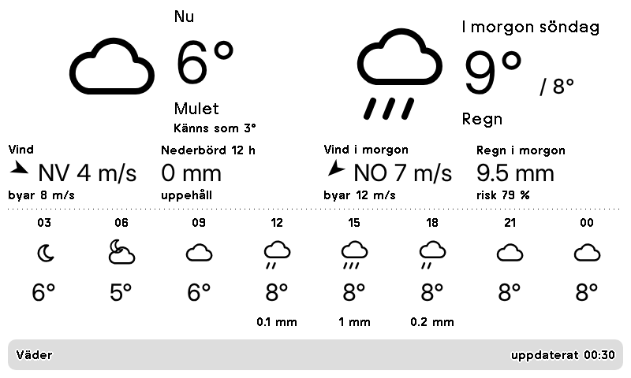

# Väder – nu och i morgon

Plugin för [TRMNL](https://trmnl.com) (e-pappersskärm). Temperatur, känns-som, vind med byar och riktning (m/s), nederbörd och snö, nu och i morgon, plus en remsa med vädret var tredje timme.



Alla fyra layouter (full, half_horizontal, half_vertical, quadrant) finns, så den fungerar i mashups.
Se [`preview/overview.png`](preview/overview.png).
Testad i liggande och stående format samt på TRMNL X: [stående](preview/full.portrait.png), [TRMNL X](preview/full.x.png).

## Inställningar

- **Plats** – sök ort eller adress (sparas som `lat,lon`)
- **Platsnamn** – valfritt, visas i titelraden

## Installera

**Import:** zippa innehållet i `src/` (platt, inga mappar) och välj TRMNL → Plugins → Private Plugin → **Import new**.

```sh
cd src && zip ../vader.zip * && cd ..
```

**[trmnlp](https://github.com/usetrmnl/trmnlp):**

```sh
trmnlp login    # en gång
trmnlp push     # laddar upp src/; lägg sedan till id: i src/settings.yml
trmnlp serve    # förhandsvisning på http://localhost:4567 med värdena i .trmnlp.yml
```

## Om

Prognos från [Open-Meteo](https://open-meteo.com) (CC BY 4.0), ingen API-nyckel. Symbolerna är inbäddade SVG-linjeteckningar som syns skarpt på e-papper.

## Licens

[MIT](LICENSE)
